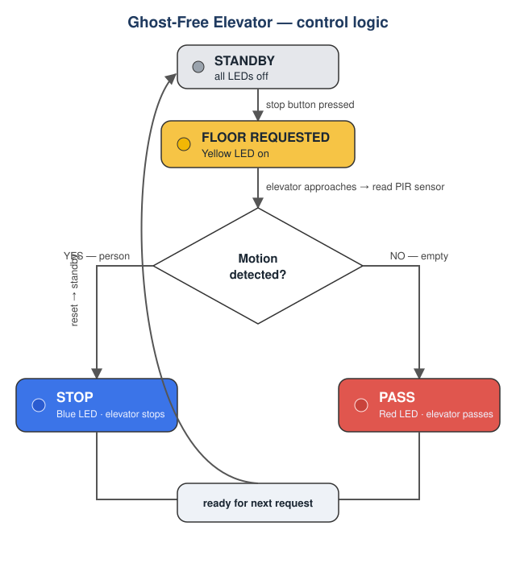

<!--
  ⚠️ 호윤에게: 이건 "초안"입니다. 그대로 올리지 말고 **네 말로** 다듬어.
  특히 "What I learned / What was hard" 부분은 네가 실제로 겪은 걸로 바꿔.
  공개 저장소이므로 전체 이름·주소·학교·연락처는 넣지 마.
-->

# Ghost-Free Elevator 🛗
*An Arduino elevator that skips floors where the button is pressed but nobody is actually waiting — saving time and energy.*

## The problem
On busy mornings, the elevator in my building stops at floor after floor with **no one waiting**. My dad joked that **a ghost must be riding it**. That stuck with me: *what if the elevator could tell whether a real person is there, and only stop when someone actually is?*

## How it works
A motion sensor is placed above the elevator door on each requested floor. When the elevator approaches that floor, it reads the sensor and decides to **stop** or **pass**.

| State | LED | Meaning |
|------|-----|---------|
| Standby / floor requested | 🟡 Yellow | A stop button was pressed |
| Person detected (motion ON) | 🔵 Blue | Someone is waiting → **STOP** |
| No one (motion OFF) | 🔴 Red | Empty floor → **PASS** |

## The build
- Arduino + **PIR motion sensor** + 3 LEDs (yellow / blue / red) + a request button
- Code: [`ghost_free_elevator.ino`](ghost_free_elevator.ino)
- Build photos: see `/photos` (from my science-fair submission)
- Original submission (Korean scan + English translation): [`docs/original-submission.md`](docs/original-submission.md)

## From idea to working model (v1 → v2)
- **v1:** I entered the idea in a local invention fair, but it was still just a concept — *"to be built with Arduino."*
- **v2:** The next year I actually **coded and wired it**: the PIR sensor, the three-LED state machine, and the stop/pass decision.
- **What was hard:** *(호윤: 센서가 엉뚱하게 반응했다든지, 배선/로직에서 막혔다가 고친 실제 이야기 1개를 여기 써)*
- **Checking if it was new:** I searched patent/science databases (KIPRIS, national science museum). The idea came back as **"no match"** — it was new to me, and that felt great.

## What I learned
*(호윤: 2~3줄, 네 말로. 예: "아이디어는 쉬웠지만 실제로 되게 만드는 건 완전히 다른 일이었다" 같은.)*

## Tech
`Arduino` · `PIR motion sensor` · `LEDs` · `digital I/O` · state-machine logic

## What's next
I want to take this further with **drones and AI** — for example, drone footage analyzed by a model to detect objects or map a path. This elevator was where I learned that I like **turning everyday annoyances into systems**.
