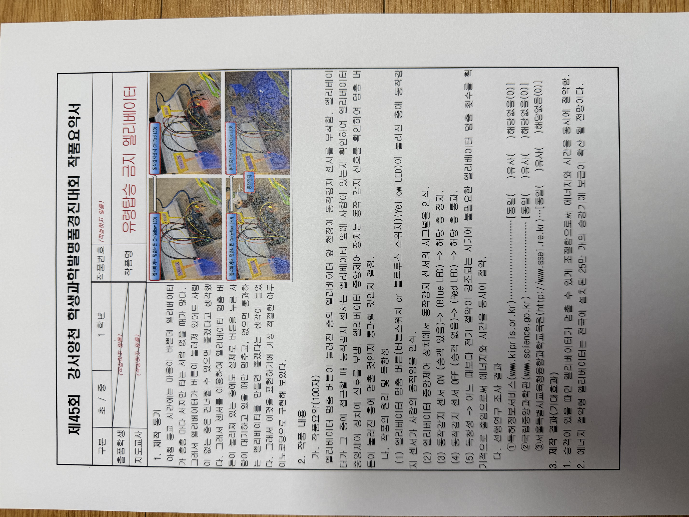
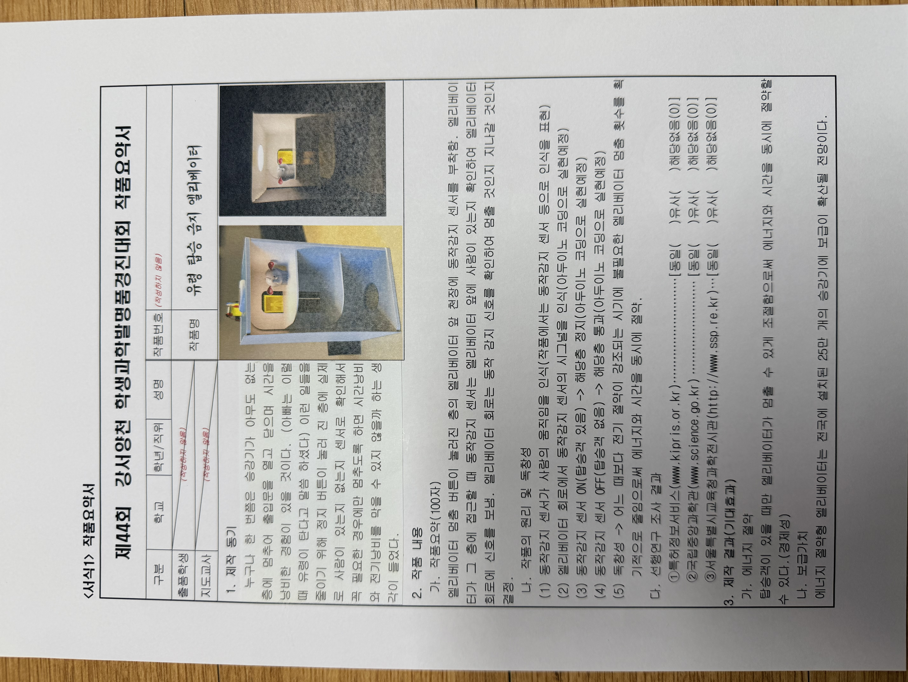

# Original Science-Fair Submission (Korean)

> The original one-page project summary I submitted to the **Gangseo-Yangcheon Student Science Invention Fair**. Scanned original (Korean) first, with an English translation below.

## Original (Korean)

*Original science-fair submission (Korean) — 45th fair (Arduino-built version)*

*Original science-fair submission (Korean) — 44th fair (earlier concept version)*

---

## English translation

**Project title:** Ghost-Free Elevator
**Event:** 45th Gangseo-Yangcheon Student Science Invention Fair — Project Summary Sheet

### 1. Motivation
On busy school mornings I'm in a hurry, but the elevator often stops at floor after floor when **no one is actually getting on**. So I thought: even if a floor's button is pressed, it would be great if the elevator could **skip floors where no one is waiting**. Using a sensor, I wanted to build an elevator that **stops at a floor with a pressed button only when a person is really waiting there, and passes by if no one is**. I decided that the best way to express this was to build it with **Arduino coding**.

### 2. Summary (100 characters)
A motion sensor is attached to the ceiling in front of the elevator on a floor whose stop button has been pressed. As the elevator approaches that floor, the motion sensor checks whether a person is in front of the elevator and sends a signal to the elevator's central controller. The controller reads the motion signal and decides whether to **stop at** or **pass** that floor.

### 3. How it works & originality
1. On a floor where the stop button (push-button or Bluetooth switch) is pressed (**Yellow LED**), a motion sensor detects a person's movement.
2. The elevator's central controller reads the motion sensor's signal.
3. Motion sensor **ON (passenger present) → Blue LED → the elevator stops** at that floor.
4. Motion sensor **OFF (no passenger) → Red LED → the elevator passes** that floor.
5. **Originality:** At a time when saving electricity matters more than ever, this dramatically reduces unnecessary elevator stops, **saving both energy and time**.

### 4. Prior-art search
Searched three official databases to check whether the idea already existed:
- Korea Patent Information Service (kipris.or.kr) → **No match**
- National Science Museum (science.go.kr) → **No match**
- Seoul Science Education Center (ssei.re.kr) → **No match**

### 5. Expected results
1. By making the elevator stop **only when a passenger is present**, it saves both energy and time.
2. An energy-saving elevator like this could be adopted across the roughly **250,000 elevators** installed nationwide.

---

> *This is my own translation of my original Korean submission; the Korean scans above are the authentic documents.*
